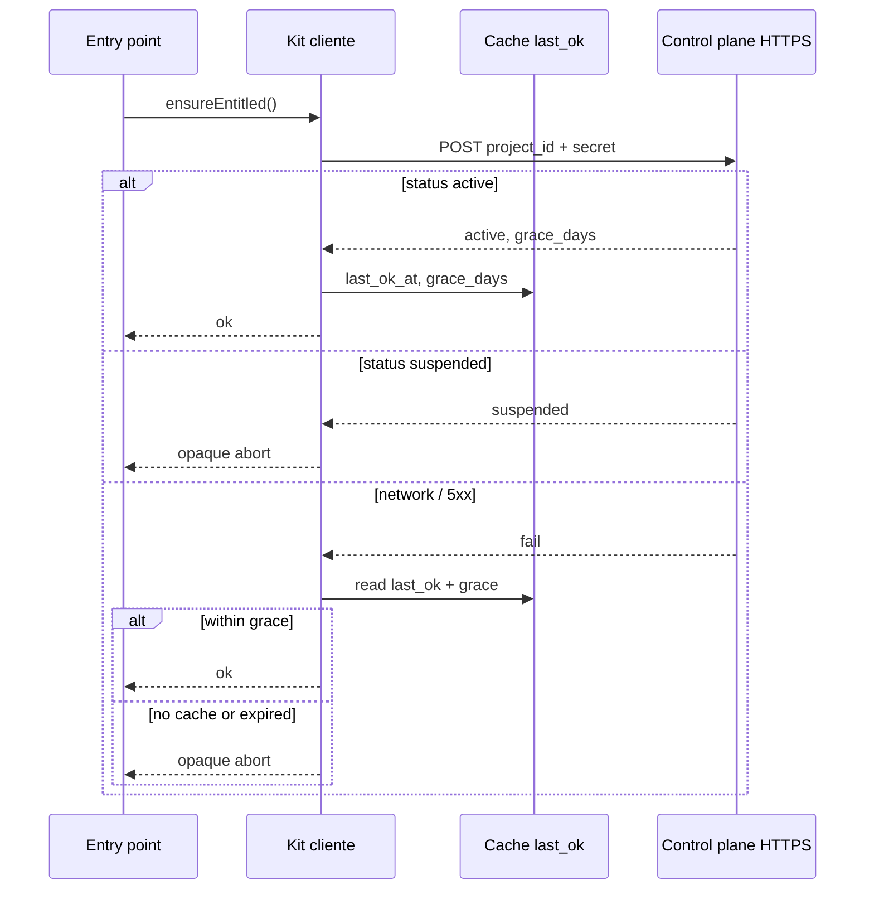

# Referencia canónica — Kill switch / entitlement (Hermes)

Contrato resumido para agents. Fuente larga en Orchestrator: `docs/architecture-kill-switch.md`.

## Idea rectora

Fricción remota, no DRM. Un **control plane personal** (Supabase del operador) decide `active` | `suspended` por `project_id`. Cada runtime (GAS, server web, Node local) pregunta al **inicio de la ejecución**. Objetivo: si cambia la gestión o no hay pago, deshabilitar trabajo útil sin depender del acceso a cuentas municipales.

## Diagrama



## Control plane (personal — not the municipal project DB)

| Piece | Notes |
| --- | --- |
| Table `entitlements` | `project_id` PK, `status` (`active`\|`suspended`), `grace_days` default **30**, `instance_secret_hash`, `notes`, `updated_at` |
| Edge Function | Validates `project_id` + raw secret; never expose table to product anon keys |
| Admin | Table Editor: flip `status`, edit `grace_days` |
| Secret storage | Hash at rest (bcrypt/argon/HMAC); never store instance secret in clear in DB |

Product repos **do not** hold this table. Only the HTTP client + env names.

## HTTP contract

`POST` to `ENTITLEMENT_URL` (Edge Function URL).

Request JSON:

```json
{
  "project_id": "acebal-example-system",
  "instance_secret": "<from env / Script Properties>"
}
```

Success body:

```json
{
  "status": "active",
  "grace_days": 30
}
```

or `"status": "suspended"`.

Auth/unknown errors: client treats like network failure (opaque) — do not leak "invalid project".

## Env names (product instance)

| Name | Where | Purpose |
| --- | --- | --- |
| `ENTITLEMENT_URL` | env / Script Property | HTTPS of Edge Function |
| `ENTITLEMENT_PROJECT_ID` | env / Script Property | Stable id registered in control plane |
| `ENTITLEMENT_INSTANCE_SECRET` | env / Script Property | Raw secret; only hash on control plane |

Never commit values. List names in `.env.example` / `orchestra.json` → `secrets`.

## Client policy (must match skill)

1. Check at **start of each execution**.
2. `suspended` → opaque abort; **grace does not apply**.
3. `active` → save `last_ok_at` + `grace_days`; continue.
4. Unreachable → continue only if `now - last_ok_at ≤ grace_days`.
5. Opaque errors: generic service/network; no license copy in UI.

### Cache by runtime

| Runtime | Cache |
| --- | --- |
| GAS | `PropertiesService` keys e.g. `entitlement_last_ok_at`, `entitlement_grace_days` |
| Node/local | gitignored file under `.data/` or similar |
| Web | Server-only; check in route/handler/middleware that gates work |

## Kit path (Orchestrator)

Canonical snippets: `templates/kill-switch/` (`client-gas.js`, `client-node.mjs`, `client-server.ts`, `README.md`).

## Out of scope (v1)

Billing UI, co-admin municipal toggle, dead-man auto-suspend, advanced obfuscation, spreadsheet as SoT read by clients, legal enforcement.
